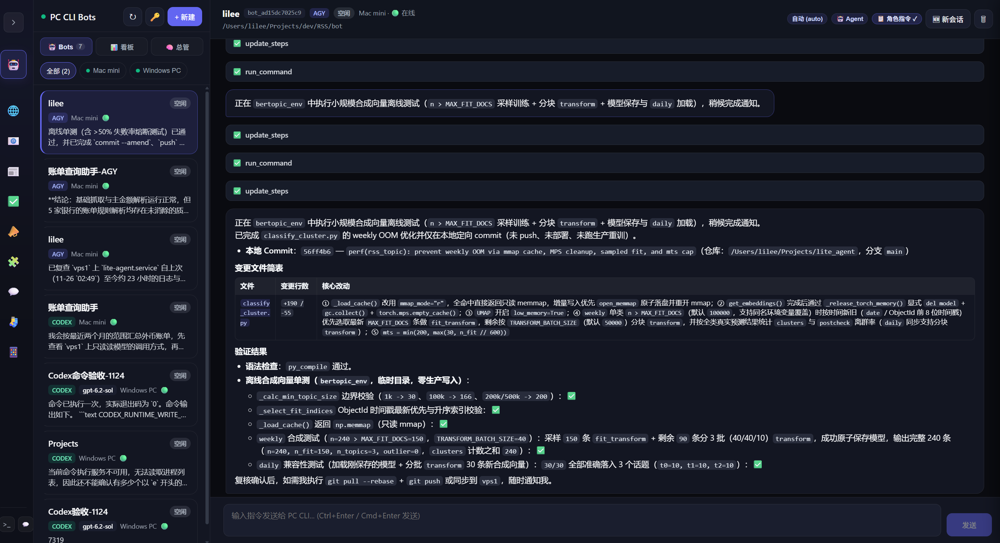
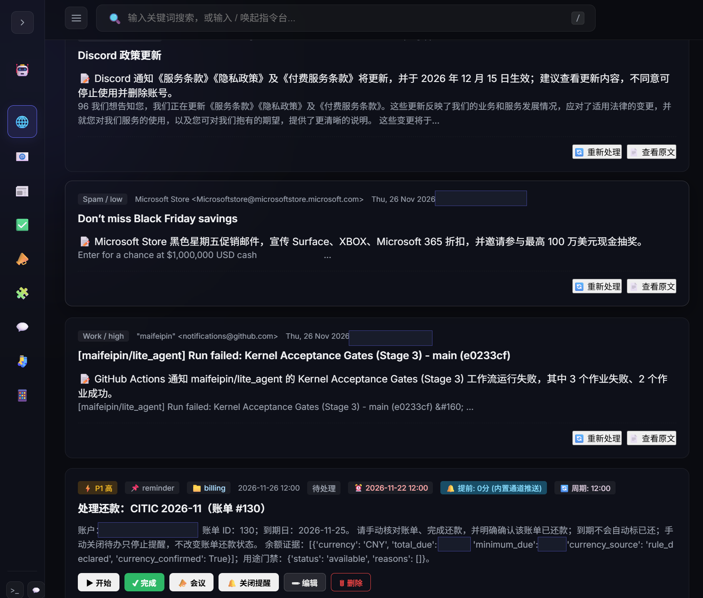
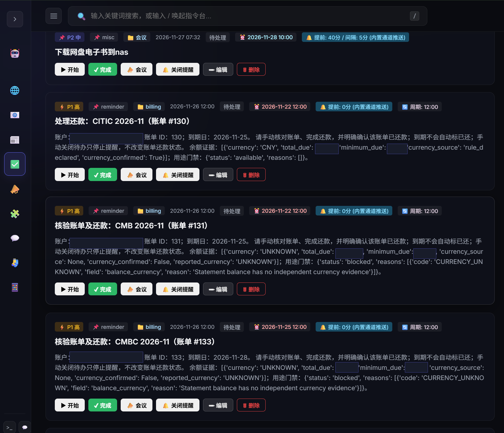

# Lite Agent

个人与多设备 AI 中枢：以统一的模型路由、会话记忆、权限控制与工具执行内核为基础，连接飞书、Telegram、钉钉、企业微信、微信 iLink、Web 控制台、移动端 PWA 与 Android 原生客户端。业务能力由九个显式插件按需装配，覆盖邮件账单解析、待办日程、多模型会审、RSS/Meilisearch 情报聚类、系统与代理网络运维、Phone App 真机筛选，以及跨 Windows / macOS 远程驱动本机 `Codex` / `AGY` 的 PC CLI 协同中枢。

## 界面预览

### 1. PC CLI Bots 跨端协同工作台（Windows / macOS 双节点 · Codex / AGY）



### 2. 多源信息流、邮件 LLM 摘要与账单待办联动

| 邮件摘要与全局情报流 | 账单解析与待办提醒中心 |
| :---: | :---: |
|  |  |

## 核心插件矩阵

`core` 模式零业务插件；`full` 模式通过 `lite_agent.app.manifests` 显式装配以下九个业务插件：

| 插件 | 模块入口 | 核心职责 |
| --- | --- | --- |
| `billing` | `lite_agent.features.billing` | 邮件账单确定性同步、对账报表、质量事件转待办与还款提醒 |
| `todo` | `lite_agent.features.todo` | 待办事项全生命周期管理、SQLite 仓储与周期提醒 |
| `review_meeting` | `lite_agent.features.review_meeting` | 多模型会审决策状态机、工具授权与异步出箱投递 |
| `mail_ops` | `lite_agent.features.mail_ops` | 多邮箱抓取、LLM 摘要打标与全文检索 |
| `content_ops` | `lite_agent.features.content_ops` | RSS 订阅早报、Meilisearch 检索、网页剪藏与知识归档 |
| `sys_ops` | `lite_agent.features.sys_ops` | 系统健康自检、数据备份、日志诊断与安全巡检 |
| `network_ops` | `lite_agent.features.network_ops` | Socks5 代理网络连通性管理与 Edge 边缘节点出站连通性调度 |
| `phone_app` | `lite_agent.features.phone_app` | 受控真机脚本审核、执行编排与三态商品筛选中枢 |
| `pc_cli` | `lite_agent.features.pc_cli` | 多 PC 节点 (`Codex` / `AGY`) 远程会话、两阶段派发、实时事件流、在线权限审批、角色指令模板与 AI 总管 |

## 客户端与多端入口

### 1. Android 客户端（含端侧离线语音）

- **最新发布页 (`Latest`)**：https://github.com/maifeipin/lite_agent/releases/latest
- **APK 直接下载**：https://github.com/maifeipin/lite_agent/releases/download/android-debug-latest/app-debug.apk
- **安装与使用**：
  1. 支持 Android 8.0（API 26）及以上（`arm64-v8a` / `armeabi-v7a`），下载 `app-debug.apk` 后允许「安装未知应用」（固定签名，后续版本可直接覆盖安装）。
  2. 首次打开默认进入 **PC Bots**，填写服务端地址并通过**账号密码登录**或 API Token 连接。
  3. 点击输入框旁 `🎙` 授予麦克风权限即可使用内置 Sherpa-ONNX 端侧离线中文语音输入；应用内支持检测 `update.json` 校验 SHA-256 在线升级。

### 2. Web 控制台与移动端 PWA

- **桌面端工作台 (`web_dashboard/`)**：聚合邮件、RSS 情报、待办、多模型会审、任务规格、Phone App 控制台与宽屏分栏式 **PC Bots** 工作台，共享统一账号会话鉴权与退出吊销。
- **移动端 PWA (`web_dashboard/mobile/`)**：零构建 Vue 3 ESM 响应式界面（同源适配手机浏览器与 Android WebView），支持 Bot 新建、目录白名单浏览与自动建目录（POSIX）、模式/模型/思考深度切换、角色指令编辑、内联折叠审批栈与 AI 总管。

### 3. PC CLI 远程守护进程 (`win-main` / `mac-mini`)

在受控 Windows 或 macOS 开发机上运行守护进程，通过出站 WebSocket 注册至 Hub：

```bash
python -m lite_agent.features.pc_cli.daemon --config /path/to/daemon.json
```

守护进程在启动时固定白名单根目录身份（防止运行期符号链接/目录联接替换越界），支持两阶段回合提交（`turn.start` → `turn.prepared` → `turn.commit`）、会话首轮角色指令注入（`<bot_instructions>`）及危险工具调用实时回传审批。

## 目录与架构边界

```text
main.py                 生产启动入口，委托 lite_agent.cli，支持 core / full

lite_agent/             运行时包
  agent.py              宿主、消息处理与显式依赖注入
  session.py            会话与消息状态
  security.py           权限与路径预检查
  cli.py                命令行解析、模式与插件装配
  app/                  应用装配、插件清单与生命周期
  contracts/            纯数据契约
  core/                 模型调用、执行、路由与编排
  services/             通用注册表、调度和投递
  channels/             通信适配器（飞书 / Telegram / 钉钉 / 企微 / 微信 iLink / HTTP API）
  features/             九个业务插件及领域服务
  skills/               工具元数据与注册载体
  integrations/         SMTP、通知、邮件解析、Phone App Worker 等外部集成
  memory_engine/        长期记忆

dev/                    开发与门禁资产，生产运行不依赖
  config/               架构规则、示例、pytest 与测试容器配置
  requirements/         core / test / full 依赖清单
  tests/                按职责归类的自动化测试套件

edge_node/              边缘节点组件
web_dashboard/          桌面 Web 控制台与 mobile/ 响应式工作台
app/android/            Android 客户端工程（Jetpack Compose + WebView + Sherpa-ONNX）
scripts/                运维与验证入口；rss_topic 为外部热点聚类与简报流水线
assets/                 图片与许可证
conf.d/                 配置分片示例；私有 JSON 不入库
```

内核不得反向依赖业务插件；业务由 `lite_agent.app` 显式加载。`lite_agent/skills/` 中的装饰器在导入时即注册工具，属载荷性导入，不能按静态扫描的“未使用”结果删除。架构规则定义在 `dev/config/architecture/rules.json`，核心导出文件与 LF SHA-256 清单位于 `dev/config/architecture/core-manifest.txt`。

规范导入入口为 `lite_agent.contracts.execution`、`lite_agent.contracts.result`、`lite_agent.services.commands` 和 `lite_agent.services.cron`。邮件质量事件与同步编排直接使用 `lite_agent.features.billing.quality_todo`、`lite_agent.features.billing.sync_service`；`lite_agent.integrations.mail` 保留外部 Parser CLI、路径与进程适配。`main.py`、技能注册和 `scripts/review_meeting.py` 等 CLI 薄入口继续保留。运行数据、密钥、`.env` 和私有配置严禁入库。

## 安装与配置

运行与 CI 基线为 **Python 3.13**。独立安装解释器并创建项目虚拟环境，不替换宿主 `/usr/bin/python3`，不复用其他项目的全局依赖。首次安装时在仓库根目录执行；已有部署不要覆盖私有配置：

```bash
python3.13 -m venv .venv313
source .venv313/bin/activate
python -m pip install -r dev/requirements/core.txt -r dev/requirements/full.txt
cp dev/config/examples/env.example .env
cp dev/config/examples/agent.json config.json
mkdir -p conf.d
cp conf.d/llm.json.example conf.d/llm.json
cp conf.d/task_routing.json.example conf.d/task_routing.json
cp conf.d/committee.json.example conf.d/committee.json
cp conf.d/output_delivery.json.example conf.d/output_delivery.json
cp conf.d/adaptive_execution.json.example conf.d/adaptive_execution.json
cp conf.d/task_specs.json.example conf.d/task_specs.json
```

填写自己的模型、频道管理员身份及业务配置，并保护配置文件权限。根目录 `config.json`、`.env` 与 `conf.d/*.json` 保持原位置。纯 `core` 环境可只安装 `dev/requirements/core.txt`。

```bash
python main.py --mode full --config config.json
python main.py --mode core --config config.json
```

`full` 模式默认装配上述九个插件。可用 `--plugins todo,review_meeting` 显式选取；CLI 插件列表优先于 `LITE_AGENT_PLUGINS` 和 `plugins.enabled`，`plugins.disabled` 仍会过滤。`core` 模式不装配业务插件。启用插件前核对其定时任务、后台 Worker 和外发目标。

邮件账单依赖外部 `mail-statement-parser` 项目，通过 `billing.script_dir` 或 `MAIL_STATEMENT_PARSER_DIR` 指定目录。解释器优先级为 `MAIL_STATEMENT_PARSER_PYTHON` → `billing.python_executable` → Parser 的 `.venv/bin/python` → `/usr/bin/python3` → 当前进程解释器。显式配置路径不存在或不可执行时直接报错，不静默回退。账单库与待办库分别通过 `billing.statement_db_path`、`billing.todo_db_path` 配置，不应混用。生产运行基线见 [VPS1 运行说明](dev/runtime_notes/vps1-python313-runtime.md)。

微信 iLink 登录必须使用运行服务的同一系统用户；账号状态保存在各自的 `data/` 中：

```bash
python3 -m lite_agent.channels.wechat_ilink --login --session-file data/wechat_session.json
```

## 开发验证

```bash
python -m pip install -r dev/requirements/test.txt
python -m pytest -c dev/config/pytest.ini --rootdir=. dev/tests/ -p no:cacheprovider -p dev.tests.support.no_skips
python scripts/check_architecture.py
python scripts/verify.py --parser-root /path/to/mail-statement-parser
```

完整验证需要 Node.js、Docker 和固定版本的 Parser checkout；当前跨仓基线为 `fa3600d813d9b0b07171baf7c8ab9aeebc77d17d`，以 CI 与隔离守卫中的声明为准。`verify.py` 的 Parser 默认位置为相邻 `../dev/mail-statement-parser`，可用 `--parser-root PATH` 覆盖。

五道 CI Gate 分别验证独立 Core、前端 Node 契约、Agent 全量回归、固定 Parser 跨仓契约和 Docker **Python 3.13** 脱敏只读双回归。每次修改列入 `dev/config/architecture/core-manifest.txt` 的核心文件后，必须同步更新其 Git LF SHA-256 哈希并通过校验。测试使用隔离配置、临时数据库与脱敏快照，禁止跳过用例冒充通过。

测试路径基于仓库位置解析，可从仓外执行，不需要全局设置 `PYTHONPATH`：

```bash
cd /tmp
/path/to/lite_agent/.venv313/bin/python -m pytest /path/to/lite_agent/dev/tests -q -p no:cacheprovider -p dev.tests.support.no_skips
```

```bash
python scripts/verify.py --core-only
python scripts/verify_core.py
python scripts/export_core.py --verify-only --check-hashes
```

测试分组：`kernel/` 内核，`architecture/` 分层与隔离，`channels/` 频道，`features/` 业务，`integration/` 跨模块与 Parser 契约，`regression/` 长期反例，`tooling/` 构建与验证工具，`frontend/` 前端契约；`support/` 为隔离守卫，`fixtures/` 为明确脱敏的机器输入。

## 调度器与关闭语义

`create_app()` 为每个应用创建专属 `CronService`，Agent、插件、配置任务、`/cron` 与健康探针使用同一实例。裸 `Agent(cron=None)` 才使用 `services.cron.default_cron_service` 兜底；显式注入的调度器不会被记忆命令初始化覆盖。技能导入不启动调度循环，CLI 在插件与配置任务注册完成后启动应用调度器。

自动任务由独立 `CronEngine` 后台线程提交到工作线程池，默认 5 个工作线程；`start()` 不等待任务执行完毕。`/cron <编号>` 手动执行仍同步返回，并与自动执行共用任务互斥。配置注册同名同定义时保留原任务对象与分钟状态，同名不同定义报错；空时间槽、非法范围等错误阻止启动，不静默遗漏任务。

应用关闭先触发 `shutdown_event` 唤醒阻塞循环并拒绝新执行，有界等待自动/手动在途任务排空与通道连接关闭，再释放插件与其他资源。停止完成、旧循环退出且在途任务排空后才允许重启。调度器仅保存内存状态，不补跑停机期间错过的时间槽，也不保证跨重启恰好执行一次；时间表达式按服务进程本地时区解释。

## 权限与工作区

通道按管理员身份区分访客，命令权限与技能执行上下文继续限制可用操作；定时任务由可信配置和插件登记，并以服务账户权限执行，不是每次经过聊天授权的请求。

`ops_workspace_run` 默认不向访客开放，脚本写入 `workspace/` 并在该目录执行，包含超时和特权命令拦截。但工作目录和 Python 审计探针不构成操作系统沙箱：脚本仍继承服务账户的文件、网络权限与进程环境，不要给生成脚本配置通用 `root` / `sudo` 权限。

## 运维入口

| 入口 | 用途 |
| --- | --- |
| `scripts/check_models.py` | 模型配置检查 |
| `scripts/debug_api.py` | 明确目标后的 API 手工诊断 |
| `scripts/review_meeting.py` | 会审 CLI 薄入口 |
| `scripts/sync_web_static.sh` | 本地或 SSH 远端发布完整 Web 资源并注入内容指纹与构建 SHA |
| `scripts/build_web_assets.py` | 构建 JS/CSS 内容哈希、HTML 版本徽章和 `build-sha` |
| `scripts/run_decision.py` | 决策 CLI |
| `scripts/gen_edge_keys.py`、`scripts/gen_htpasswd.py` | 边缘密钥及认证文件生成 |
| `scripts/switch_model.py` | 模型配置切换 |
| `scripts/switch_naive_config.sh` | 受限代理网络配置切换脚本 |
| `scripts/backup_to_bypy.sh`、`full_backup_once.py`、`rsslite_full_backup.py` | 备份入口，执行前确认目标和权限 |
| `scripts/rss_topic/` | RSS Topic 跨端流水线（导出过滤、BERTopic 分类聚类、命名熔断、Meilisearch 回写与 24h 热点简报） |

Web 发布示例：

```bash
./scripts/sync_web_static.sh /path/to/nginx/dist
./scripts/sync_web_static.sh --remote vps1
```

默认本地目标是 `/var/www/dashboard/dist`。页面保留 Web 构建 SHA 并与服务端 `/health`（或 `/api/v1/health`、`/agent/health`）返回的构建信息比对。

许可证见 [assets/LICENSE](assets/LICENSE)。
